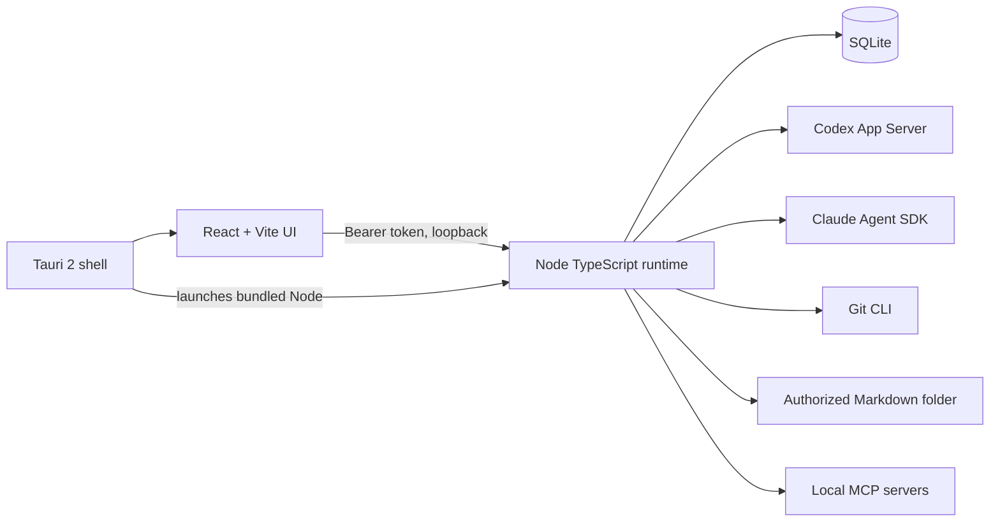

# Forge Studio

Forge Studio is a local-first Windows desktop workspace for AI-assisted development. It brings project context, coding tasks, Markdown knowledge, Git inspection, and local tool connections into one application.

The application uses a Tauri 2 shell, a React interface, and a TypeScript Node.js runtime. Project and task data stay in a local SQLite database.

## What works today

| Area            | Current capability                                                                                                                                         |
| --------------- | ---------------------------------------------------------------------------------------------------------------------------------------------------------- |
| Projects        | Import an existing directory, choose a project-specific Markdown folder, and persist settings.                                                             |
| Agent workspace | Run Codex tasks in manual or plan-first assisted mode. Stream responses, approve or reject assisted plans, stop work, and review the outcome.              |
| Claude          | Agent SDK adapter is implemented; a live run requires `ANTHROPIC_API_KEY`.                                                                                 |
| Knowledge base  | Search and read Markdown notes, preview proposed edits, and apply reviewed changes.                                                                        |
| Git & changes   | Inspect the current branch, working tree status, and unstaged diff.                                                                                        |
| MCP connections | Add trusted local stdio servers, connect and inspect advertised tools, and store per-project tool permissions. Forge Studio does not invoke MCP tools yet. |
| Activity        | Reopen persisted tasks, events, and decisions.                                                                                                             |

The [implementation status](docs/development/status.md) records verified behavior and open checks. Planned integrations are listed in the [roadmap](#roadmap).

## Run from source

Development requires Windows 11, Node.js 24, pnpm 9, and Git. Native Tauri builds also require Rust stable with the MSVC toolchain and Visual Studio C++ Build Tools.

```powershell
pnpm install
pnpm dev
```

Open `http://127.0.0.1:5173`. This starts the React UI and local runtime with a shared random development token.

To open the native development window, run `pnpm desktop:dev`. To create a Windows installer, run `pnpm desktop:build`; the NSIS setup file is written to `apps/desktop/src-tauri/target/release/bundle/nsis/`. A public release download is not available yet.

## Configure an agent

1. Import an existing project directory. Importing does not change its files.
2. Optionally select a project-specific Markdown folder, such as a folder in an Obsidian vault.
3. Install the Codex CLI and run `codex login` before starting Codex tasks. Forge Studio uses the Codex App Server from that installation.
4. For Claude tasks, set `ANTHROPIC_API_KEY` in your local environment before starting Forge Studio. Do not commit the key.
5. Choose **Manual** to start a task immediately or **Assisted** to review a plan first. Review the response and Git snapshot before accepting the task outcome.

For MCP, add a trusted local server command in **MCP Connections**, enter its arguments as a JSON array, and select **Connect & inspect**. Project tool switches are stored for future workflows; they do not enable tool execution in the current release. Avoid putting credentials in command arguments.

## Architecture and local data



The runtime binds to `127.0.0.1`, requires a bearer token, and checks browser origins. Direct Markdown operations resolve real paths and reject traversal or junction escapes. Agent process isolation depends on the provider and is not a hardened sandbox. Interrupted tasks are marked paused after a restart and are not replayed automatically.

SQLite state is stored under `%APPDATA%\Forge Studio\forge.db`, or under `FORGE_DATA_DIR` when set. Database files, logs, credentials, and generated runtime bundles are excluded from Git. See the [architecture](docs/architecture/overview.md), [security model](docs/security/model.md), and [integration notes](docs/integrations.md).

## Roadmap

- Complete native UI and clean-machine installer checks, then verify the remaining provider approval flows.
- Add reviewed Git write actions and permissioned MCP tool calls with audit records.
- Connect and test supported Roblox Studio, Blender, and VS Code workflows.
- Add bounded coordinated tasks with planning, implementation, review, QA, and documentation stages.
- **Connect Forge CLI and Forge Studio:** define a versioned local interface for Forge CLI, let users opt into a connection, map both tools to the same project context, and hand off tasks with visible logs and approval boundaries. This integration is planned; the two tools do not communicate today.

## Verify

```powershell
pnpm check
pnpm lint
pnpm build
```

## License

Forge Studio's own source code is licensed under the [MIT License](LICENSE). Third-party components keep their own licenses or terms. In particular, the [Claude Agent SDK is governed by Anthropic's terms](https://github.com/anthropics/claude-agent-sdk-typescript/blob/main/LICENSE.md); review them before redistributing a packaged installer.
