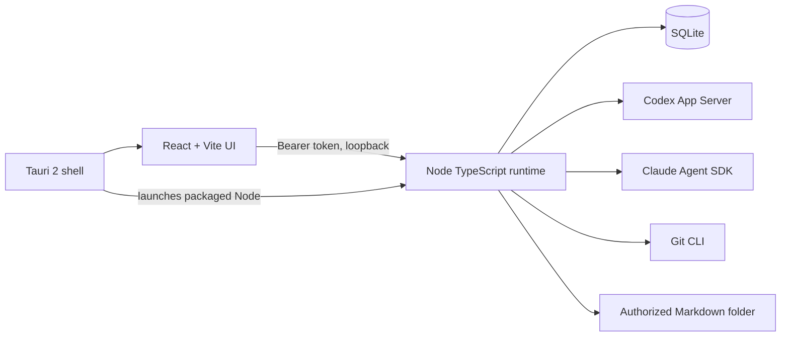

# Forge Studio

Forge Studio is a local-first Windows development workspace for project-scoped AI tasks, Git inspection, and Obsidian Markdown notes. This repository is separate from Forge CLI and Catch a Slime.

## Current status (2026-10-23)

The React interface and Node runtime run locally. Project import/settings, SQLite task and event persistence, manual and plan-first tasks, approvals, cancellation, Markdown browsing and reviewed edits, and Git status/diff are implemented. Real Codex App Server turns streamed through the UI; assisted plan approval, rejection, Stop, and human outcome review were verified. A reviewed Markdown edit was applied through the UI in a disposable folder. The local MCP manager now saves stdio servers, explicitly connects and inspects tools, disconnects, and stores per-project tool switches. Tool invocation by agents is not yet available. The Claude Agent SDK adapter is implemented but cannot be live-tested here without an Anthropic API key. Roblox Studio MCP, Blender, Git write operations, coordinated multi-agent workflows, and automatic documentation edits are planned.

See [implementation status](docs/development/status.md) for verified evidence and limitations.

## Requirements

- Windows 11, Node.js 24, pnpm 9, Git.
- Rust stable MSVC and Visual Studio C++ Build Tools for Tauri development/builds.
- Codex CLI installed and `codex login` for Codex tasks.
- `ANTHROPIC_API_KEY` for Claude Agent SDK tasks. This uses separately billed Anthropic API access; Claude.ai subscription login is not exposed to this third-party application by the current SDK terms.

## Development

```powershell
pnpm install
pnpm dev
```

Open `http://127.0.0.1:5173`. The command launches the Vite UI and loopback runtime with a shared random session token.

For the native Tauri window:

```powershell
pnpm desktop:dev
```

The app stores SQLite state under `%APPDATA%\Forge Studio\forge.db`, or `FORGE_DATA_DIR` if set. The database and tokens are ignored by Git.

## Verification and packaging

```powershell
pnpm check
pnpm build
pnpm desktop:build
```

The desktop build prepares a private runtime bundle, copies the installed Node executable as a Tauri resource, then creates an NSIS installer at `apps/desktop/src-tauri/target/release/bundle/nsis/`. The installer was built and installed on this Windows machine, and the packaged shell started its loopback runtime. Clean-machine startup and shutdown still need verification before distribution. Code signing and update distribution remain open. Startup output is written to the Tauri app log directory as `runtime.log`.

## Setup

1. Import a project by entering its existing absolute directory. Import does not edit the directory.
2. Optionally enter a project-specific folder inside an Obsidian vault. Notes remain ordinary local Markdown files.
3. Run `codex login` before using Codex. The adapter starts the official Codex App Server and uses its existing sign-in.
4. To use Claude, set `ANTHROPIC_API_KEY` in the environment before starting Forge Studio. Keep the key out of repository files.
5. Choose Manual to execute immediately, or Assisted to generate a read-only plan and approve it before execution. After the provider finishes, review its response and Git snapshot, then accept or mark the task unsuccessful.
6. In MCP Connections, add a trusted local stdio server command and its arguments as a JSON array, then choose Connect & inspect. Enabling a discovered tool records project permission for future workflows; no MCP tool calls are made in this release. Avoid putting credentials in command arguments.

## Architecture



See [architecture](docs/architecture/overview.md), [security model](docs/security/model.md), and [integration notes](docs/integrations.md).

## Security and troubleshooting

The local API binds to `127.0.0.1`, requires a random bearer token, checks browser origins, and keeps database files out of Git. Direct Markdown operations resolve real paths and reject traversal and junction escapes. Agent process isolation is provider dependent; do not treat this as a hardened sandbox. Inspect each approval request before accepting. Restarting marks interrupted tasks as paused and does not replay them automatically.

If the UI shows “Unauthorized,” start both services with `pnpm dev` so they share a token. If Codex fails, run `codex login status` and check the task error. If Claude fails, check `ANTHROPIC_API_KEY` and Anthropic API billing. If the Tauri build fails, confirm Rust MSVC and C++ Build Tools are available.

## License

No license has been chosen for Forge Studio. The repository should remain private until a license decision is made. Third-party dependencies retain their own licenses.
