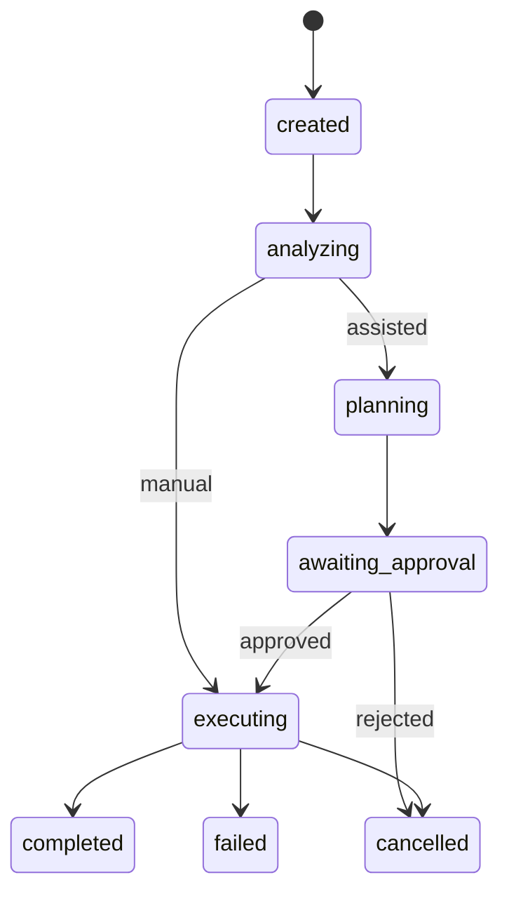

# Agent Orchestration

Manual mode sends the request to one selected provider. Assisted mode sends a read-only planning request, persists its text, waits for approval, and then starts execution. Codex JSON-RPC and Claude SDK messages are translated into common text, tool, session, approval, error, and completion events.

There is no concurrent coordinated mode yet. A provider's completed turn currently closes the task; independent test evidence and review stages remain planned. See [[04 Development/Known Issues|Known Issues]].
