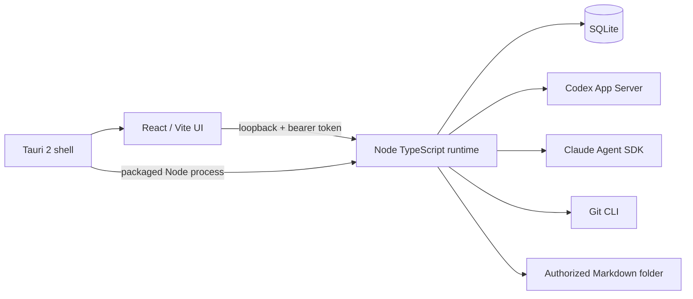

# System Architecture

The runtime owns project validation, task state, approvals, provider adapters, and direct filesystem operations. SQLite keeps task events and resumes UI history after a restart. Interrupted tasks become paused and are never replayed silently. The UI is a client of typed JSON and server-sent events.

See [[02 Architecture/Agent Orchestration|Agent Orchestration]], [[02 Architecture/Database Schema|Database Schema]], and [[02 Architecture/Security Model|Security Model]]. The NSIS package started its Node runtime locally, and a Codex turn streamed in the browser UI. Native UI and clean-machine tests remain.
